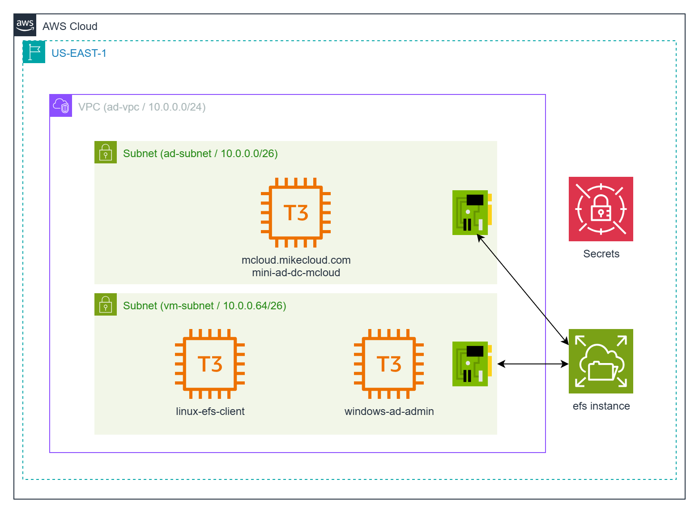
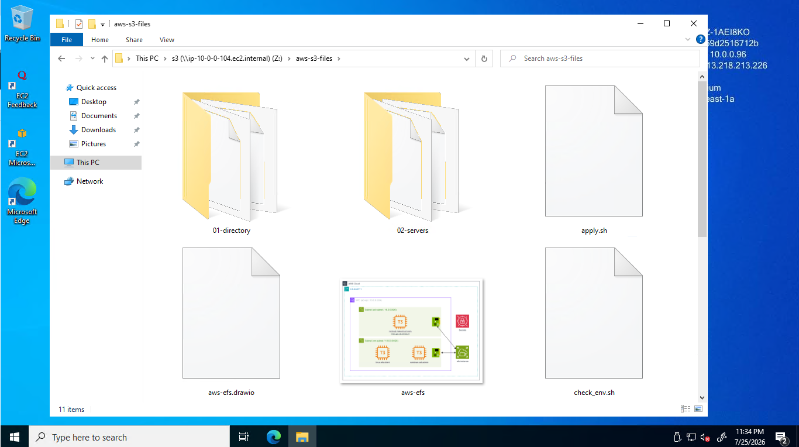
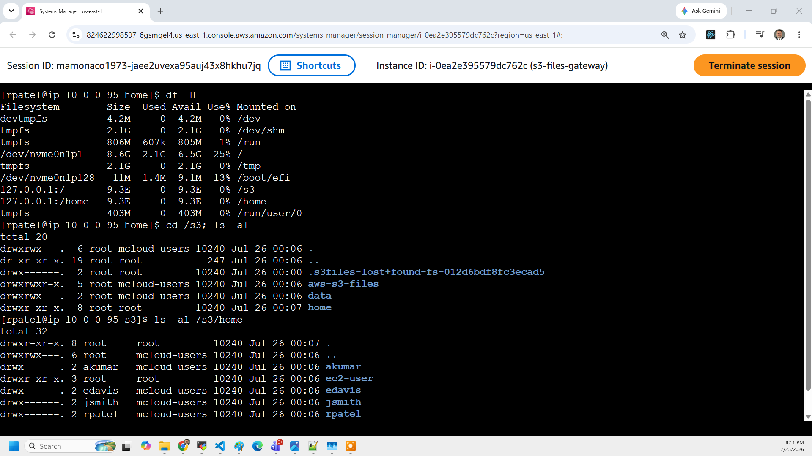

# AWS Mini Active Directory with S3 Files: NFS & Samba File Sharing

This project extends the original **AWS Mini Active Directory** lab by using **Amazon S3 Files** as the shared storage backend. Amazon S3 Files (GA April 2026) presents an ordinary S3 bucket as a fully-featured, high-performance **NFS v4.2** file system — the bucket stays the source of truth while S3 Files, built on Amazon EFS under the hood, serves the active working set with low latency and syncs writes back to S3.

This solution exposes that storage in two ways:

1. **Direct NFS Mounts on Linux Clients** – Linux machines joined to the mini-AD domain mount the S3 Files file system directly for POSIX-style access to objects.
2. **Samba File Server on Linux** – Because S3 Files is Linux/NFS only, a Linux client mounts it locally and re-exports it over **Samba/SMB**, letting domain-joined Windows machines reach the same S3-backed data.

The mini-AD environment (Samba 4 on Ubuntu) provides Active Directory authentication and DNS. S3 Files provides file-system access to object storage. Together they enable a hybrid setup where both Linux and Windows domain-joined clients consume the same S3 bucket as files.



> **Note:** The architecture diagram and console screenshots are carried over from the EFS version and still need to be regenerated to reflect S3 Files.

## Understanding Amazon S3 Files

**Amazon S3 Files** is a managed shared file system that gives file-based applications direct NFS access to data stored in a standard S3 bucket — with no download-process-upload cycle and no data duplication. Both the NFS mount and the S3 API operate on the same objects simultaneously, with S3 remaining the authoritative store.

### How It Works
- You create an **S3 Files file system** over a **versioned** S3 bucket, then place a **mount target** (an NFS endpoint / ENI) in each subnet.
- Clients mount it with the `mount.s3files` helper (shipped in **amazon-efs-utils 3.0.0+**) using the file-system id: `mount -t s3files fs-xxxx:/ /mnt`.
- S3 Files is **built on Amazon EFS**, which intelligently caches the active working set on high-performance storage. Writes are aggregated (~60s) and synced back to S3.

### When to Use S3 Files
- **File apps over object data** – Legacy or POSIX-expecting apps that need to read/write data that lives in S3.
- **ML / analytics pipelines** – Mount a bucket of training data or artifacts as files without copying it first.
- **Shared datasets** – Many Linux compute resources (EC2, Lambda, ECS, EKS, Fargate, Batch) reading the same S3 data as a filesystem.

### Key Benefits
- **S3 economics, file access** – Data stays in S3; up to ~90% lower cost than cycling data between S3 and a separate file system.
- **No capacity planning** – Elastic, pay-as-you-go, no provisioned throughput.
- **High concurrency** – Up to 25,000 simultaneous connections and multi-TB/s aggregate read throughput per bucket.
- **Dual access** – The same objects are reachable via NFS and the S3 API at once.

### Limitations of S3 Files

- **Linux / NFS only** – SMB is not supported. Windows clients need a gateway (as demonstrated here) or FSx.
- **Eventual write sync** – File-system writes aggregate for up to ~60 seconds before appearing via the S3 API.
- **Locks bypassed by S3 API** – NFS file locks are ignored by direct S3 operations; avoid concurrent write paths to the same object.
- **Conflict handling** – The S3 bucket is the source of truth; conflicting file-system changes are moved to a `.s3files-lost+found-{file-system-id}` directory.
- **Versioning required** – The backing bucket must have versioning enabled.
- **Not for live home directories** – The write-aggregation and lock semantics make it a poor fit for interactive home dirs (this lab keeps `/home` local for that reason).

**Tip:** Use **S3 Files** when you want file-system access to data that should live in S3. For Windows-native SMB with ACLs and DFS, consider **FSx for Windows File Server**. For enterprise NAS with snapshots, cloning, and automatic S3 tiering, consider **FSx for NetApp ONTAP**.

## AWS Storage Cost Comparison (1 TB / month, us-east-1)

| Service          | Cost per GB-month | 1 TB Cost (approx) | Notes |
|------------------|------------------:|-------------------:|-------|
| **S3 Standard**  | $0.023            | **$23.50**         | Object storage; the backing store for S3 Files |
| **S3 Files**     | S3 storage + usage-based file-system fee | **varies** | File access billed on top of S3 storage; no provisioned capacity |
| **EBS gp3**      | $0.080            | **$81.92**         | Block storage, single-instance use |
| **EFS Standard** | $0.300            | **$307.20**        | Shared NFS file system, elastic scaling across AZs |

## Prerequisites

* [An AWS Account](https://aws.amazon.com/console/)
* [Install AWS CLI](https://docs.aws.amazon.com/cli/latest/userguide/getting-started-install.html) — **v2.34 or later** (S3 Files support)
* [Install Latest Terraform](https://developer.hashicorp.com/terraform/install) — with **AWS provider >= 6.40** (for the `aws_s3files_*` resources)

If this is your first time watching our content, we recommend starting with this video: [AWS + Terraform: Easy Setup](https://youtu.be/BCMQo0CB9wk). It provides a step-by-step guide to properly configure Terraform, Packer, and the AWS CLI.

---

## Download this Repository

```bash
git clone https://github.com/mamonaco1973/aws-s3-files.git
cd aws-s3-files
```

---

## Build the Code

Run [check_env](check_env.sh) to validate your environment, then run [apply](apply.sh) to provision the infrastructure.

```bash
develop-vm:~/aws-s3-files$ ./apply.sh
NOTE: Validating that required commands are found in your PATH.
NOTE: aws is found in the current PATH.
NOTE: terraform is found in the current PATH.
NOTE: All required commands are available.
NOTE: Checking AWS cli connection.
NOTE: Successfully logged into AWS.
Initializing the backend...
Initializing provider plugins...
Terraform has been successfully initialized!
```

---

### Build Results

When the deployment completes, the following resources are created:

- **Networking:**
  - A VPC with public and private subnets
  - Internet Gateway and NAT Gateway for controlled outbound access
  - Route tables configured for both public and private subnets

- **Security & IAM:**
  - Security groups for the domain controller, Linux client, Windows client, and S3 Files mount targets
  - An IAM **service role** assumed by S3 Files to access the bucket and manage its EventBridge change rule
  - IAM roles and policies allowing EC2 to use AWS Systems Manager, read secrets, and **client-mount** the S3 Files file system
  - Secrets stored in AWS Secrets Manager for AD administrator and test user credentials

- **Active Directory Server:**
  - Ubuntu EC2 instance running Samba 4 as a Domain Controller and DNS server
  - Configured Kerberos realm and NetBIOS name
  - Administrator credentials managed in AWS Secrets Manager

- **Amazon S3 Files:**
  - A versioned S3 bucket backing the file system
  - An S3 Files file system with NFS mount targets in each private subnet
  - Security group allowing NFS traffic (TCP/2049) from the domain-joined clients

- **Linux Client Instance:**
  - Domain-joined Ubuntu EC2 instance with SSSD integration
  - Mounts the S3 Files file system directly via NFS at `/s3`
  - Re-exports `/s3` as a **Samba share**, enabling Windows clients to access the same S3-backed data

- **Windows Client Instance:**
  - Domain-joined Windows Server EC2 instance
  - Maps drive `Z:` to the Samba `s3` share hosted on the Linux client
  - Supports domain-authenticated users for SMB access

---

### Users and Groups

As part of this project, when the domain controller is provisioned, a set of sample **users** and **groups** are automatically created through Terraform-provisioned scripts running on the mini-ad server. These resources are intended for **testing and demonstration purposes**, showcasing how to automate user and group provisioning in a self-managed Active Directory environment.

#### Groups Created

| Group Name    | Group Category | Group Scope | gidNumber |
|---------------|----------------|-------------|-----------|
| mcloud-users  | Security       | Universal   | 10001     |
| india         | Security       | Universal   | 10002     |
| us            | Security       | Universal   | 10003     |
| linux-admins  | Security       | Universal   | 10004     |

#### Users Created and Group Memberships

| Username | Full Name   | uidNumber | gidNumber | Groups Joined                     |
|----------|-------------|-----------|-----------|-----------------------------------|
| jsmith   | John Smith  | 10001     | 10001     | mcloud-users, us, linux-admins    |
| edavis   | Emily Davis | 10002     | 10001     | mcloud-users, us                  |
| rpatel   | Raj Patel   | 10003     | 10001     | mcloud-users, india, linux-admins |
| akumar   | Amit Kumar  | 10004     | 10001     | mcloud-users, india               |

---

#### Understanding `uidNumber` and `gidNumber` for Linux Integration

The **`uidNumber`** (User ID) and **`gidNumber`** (Group ID) attributes are critical when integrating **Active Directory** with **Linux systems**, particularly in environments where **SSSD** ([System Security Services Daemon](https://sssd.io/)) or similar services are used for identity management. These attributes allow Linux hosts to recognize and map Active Directory users and groups into the **POSIX** (Portable Operating System Interface) user and group model.

---

### Log into Windows Instance

When the Windows instance boots, the [userdata script](02-servers/scripts/userdata.ps1) executes the following tasks:

- Install Active Directory Administrative Tools
- Install AWS CLI
- Join EC2 instance to Active Directory
- Grant RDP access to domain users
- Map drive `Z:` to the Samba `s3` share
- Perform a final system reboot

Administrator credentials are stored in the `admin_ad_credentials_s3` secret.



---

### Log into Linux Instance

When the Linux instance boots, the [userdata script](02-servers/scripts/userdata.sh) runs the following tasks:

- Update OS and install required packages (including `amazon-efs-utils` for the `mount.s3files` helper)
- Install AWS CLI
- Join the Active Directory domain with SSSD
- Enable password authentication for AD users
- Configure SSSD for AD integration
- Grant sudo privileges to the `linux-admins` group
- Mount the S3 Files file system at `/s3` and share it via Samba for Windows access

Linux user credentials are stored as secrets.



---

### Clean Up Infrastructure

When you are finished testing, you can remove all provisioned resources with:

```bash
./destroy.sh
```

This will use Terraform to delete the VPC, EC2 instances, IAM roles, security groups, the S3 Files file system, and the backing S3 bucket. Secrets stored in AWS Secrets Manager are force-deleted. Note that if the backing bucket contains objects, you may need to empty it before the bucket can be destroyed.
